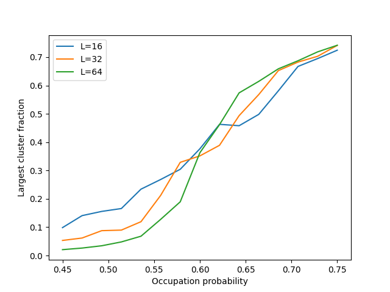
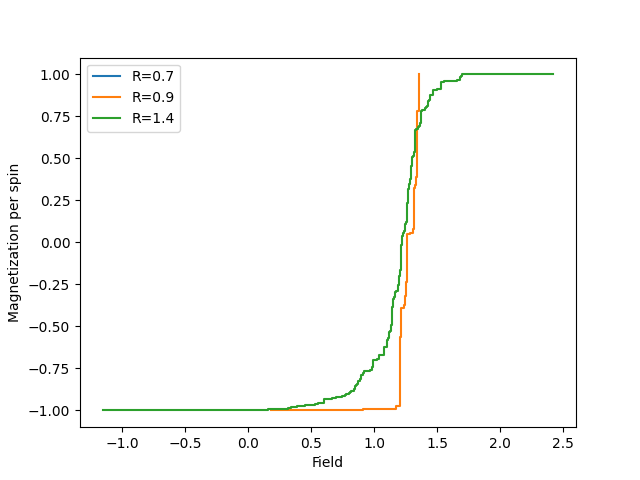
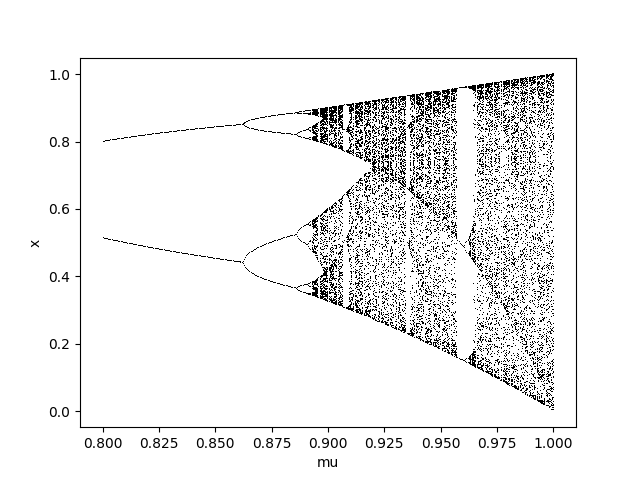
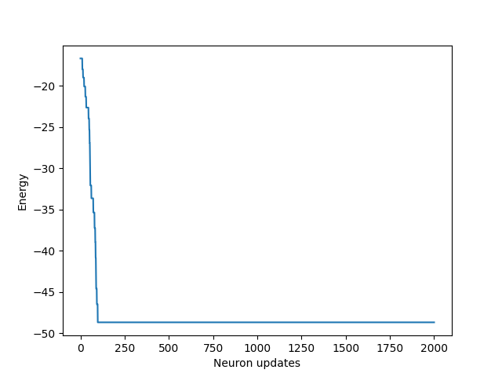

# Computational Physics and Complex Systems

Numerical investigations of statistical mechanics, collective behaviour, phase transitions, nonlinear dynamics and associative memory.

## Overview

This project explores how macroscopic phenomena emerge from microscopic interactions and how numerical methods can reveal the statistical properties of complex systems.

The models span equilibrium statistical mechanics, disordered systems, critical phenomena, deterministic chaos and neural dynamics.

## 1. Ising Model

The Ising model describes interacting binary spins through the Hamiltonian

$$
H=-J\sum_{\langle i,j\rangle}s_i s_j-h\sum_i s_i,
\qquad s_i\in\{-1,+1\}.
$$

The numerical implementation investigates collective spin behaviour using periodic boundary conditions and Monte Carlo dynamics.

The project also explores spatial segregation through the Schelling model, illustrating how local interaction rules can produce large-scale spatial organization.

## 2. Percolation Theory

Percolation investigates the emergence of connected structures in randomly occupied systems.

Both site and bond percolation are considered, with numerical analysis of connectivity and spanning behaviour under open boundary conditions.

The simulations illustrate the relationship between occupation probability, connectivity and critical phenomena.

## 3. Random-Field Ising Model and Avalanches

The random-field Ising model introduces spatial disorder through local random fields:

$$
H=-J\sum_{\langle i,j\rangle}s_i s_j
-\sum_i(H_{\mathrm{ext}}+h_i)s_i.
$$

Under changes in the external field, interacting spins can undergo collective rearrangements known as avalanches.

The numerical experiments investigate avalanche behaviour in disordered interacting systems.

## 4. Nonlinear Dynamics and Chaos

The logistic map is defined by

$$
x_{n+1}=rx_n(1-x_n).
$$

Despite its simple deterministic structure, the system exhibits transitions between stable and chaotic behaviour.

Numerical experiments explore the evolution of the system as its control parameter varies.

## 5. Hopfield Networks

Classical Hopfield networks describe associative memory through interacting binary states.

The energy function is

$$
E=-\frac{1}{2}\sum_{i,j}w_{ij}s_i s_j.
$$

The implementation investigates memory retrieval using a zero-diagonal weight matrix and deterministic tie handling.

A continuous softmax-based retrieval model is also included to explore modern associative memory mechanisms.

## Numerical Methodology

- Monte Carlo methods
- Discrete lattice simulations
- Periodic and open boundary conditions
- Seeded stochastic experiments
- Controlled parameter sweeps
- Matched disorder realizations
- Statistical and numerical analysis
- Automated model validation

Finite-size simulations are used to investigate qualitative physical behaviour rather than establish high-precision universal critical exponents.

## Repository Structure

| Module | Description |
|---|---|
| `ising.py` | Interacting spin systems |
| `percolation.py` | Site and bond percolation |
| `avalanches.py` | Disordered spin systems and avalanches |
| `chaos.py` | Nonlinear dynamical systems |
| `hopfield.py` | Associative memory models |
| `experiment.py` | Numerical experiments and visualization |
| `test_models.py` | Automated model tests |

## Reproducibility

    pip install -r requirements.txt
    python -m pytest -q
    python experiment.py

Generated figures are saved in `results/`.

## Technologies

Python, NumPy, SciPy, Matplotlib, statistical mechanics, numerical simulation and nonlinear dynamics.