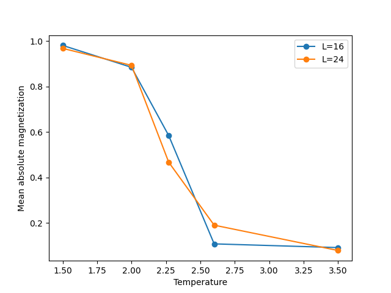

# Computational physics and complex systems


A consolidated implementation of five undergraduate laboratory topics: Ising/Schelling models, site and bond percolation, random-field Ising avalanches, logistic-map chaos and classical/modern Hopfield memories. The original PDFs were guided exercises; the modules here are rewritten implementations, not a claim of independent original research.

Experiments use seeded generators, explicit sweeps, matched disorder realizations for benchmark comparison, and a zero-diagonal Hopfield weight matrix with a deterministic tie rule. Percolation uses open boundaries; Ising and avalanche simulations use periodic boundaries. Finite-size results are illustrative, not precise estimates of universal exponents. Modern Hopfield implementation uses continuous softmax retrieval; it is a new extension rather than an exact copy of the coursework. Urban population grid was not supplied; optional CSV analysis is provided. No instructor-supplied text or utility code is distributed.

## Run
```bash
python -m venv .venv
# Activate the environment for your OS, then:
pip install -r requirements.txt
python -m pytest -q
python experiment.py
```
Generated figures are in `results/`.

## Local verification
Default experiment executed successfully in the preparation environment. Output is recorded in `experiment.log`; generated artifacts are under `results/`. Runtime measurements are machine-dependent.

### Selected output



